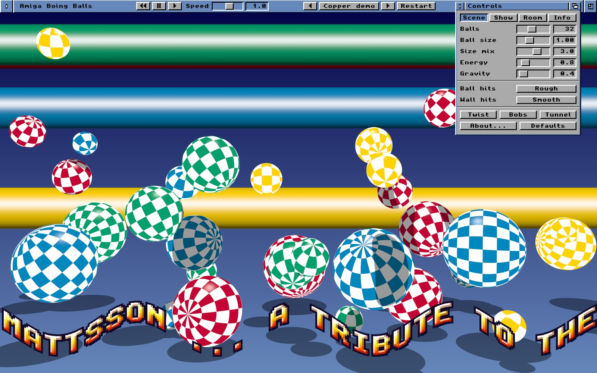

# Amiga Boing Balls

A tribute to my favorite demo of all time. Use the mouse to orbit and zoom, and click the balls to push them.

Featured on Experiments with Google
https://experiments.withgoogle.com/amiga-boing-balls

View the demo on GitHub Pages
https://johnmattsson.github.io/AmigaBoingBalls/index.html



## Controls

| Action | Mouse | Touch |
|---|---|---|
| Orbit the camera | drag | drag with one finger |
| Zoom | scroll wheel | pinch |
| Push a ball | click it | tap it |
| Do something to a square of the grid: flip, spin, shrink or slide it by chance, showing space behind it, or paint it (Look: Tile clicks, with Backdrop: None) | click the room | tap the room |

Keys:
- **Space**: pause, or carry on at the speed it had.
- **R**: start the preset again.
- **F**: full screen on or off.
- **Escape**: leave full screen, or else close the window in front.
- **G**: a Guru Meditation; any key or click takes it away again.
- **N**: "Oh no!": a count from 5 over every ball, then they burst one after another into the squares and triangles they are made of (at most 20,000 pieces in all), which rain down and stay on the floor, in memory of a game from 1991 (the close gadget does it too, every other time). **R** brings them back.
- **Tab**: on to the next button or slider.
- In a menu (opened by a button that shows a choice, or with **Down** on it): **Up**/**Down** go through the choices, **Home**/**End** to the first or last, **Enter** or **Space** chooses, **Escape** closes it without choosing.
- On a slider (click it, or reach it with Tab): the arrow keys move it a step, **Page Up**/**Page Down** a tenth of the way, **Home**/**End** to either end.

The speed of time is on the title bar, with buttons to run backwards (<<), pause (||) and run forwards (>). While time runs backwards, "<< REWIND" blinks below it. The presets are on the title bar too, next to the speed gadgets: the name opens the preset menu.

The Controls window (top right) has three pages: **Scene** (the balls, how they bounce, gravity, and the sound), **Look** (trails, the backdrop, Tile clicks, the scroller, the room, the lamp, Pixel size and HDR) and **Info** (the physics at work, Precision and the Rewind test). Try a negative speed to run time backwards. Rewinding retraces the path very accurately, but not forever: bouncing balls are chaotic, so tiny rounding errors (in the 16th digit) grow with every collision between balls. In practice the rewind is spot-on for some twenty hits of each ball, then drifts onto a different path.

## Presets

Twelve ready-made scenes. They're on the title bar next to the speed gadgets (on a second row in narrower windows): the name opens the preset menu, < and > step through them, and Restart starts the scene again. The page starts with Four balls. Choosing a preset puts every option back to its usual value (only your own settings are left alone: the volumes, Glints, Pixel size, HDR and Tile clicks) and turns the camera to the front.

The shows:
- **Four balls**: the page's start.
- **Classic 1984**: one big ball as in the original, with its shadow on the back wall.
- **Carousel**: 48 balls in the box, while the camera circles above the ceiling.
- **Copper demo**: balls of all sizes filling the whole window over the copper bars, with the scroller and music.
- **Megademo**: a demo as they were made for the Amiga, one part after another:
  - each part lasts some twenty seconds, with a fade through black between them, and the scroller and music running all the while;
  - it opens with the ball of 1984 and its boing, then shows the balls over each backdrop in turn and, in between, in front of the Twist, the Vector Bobs and the Tunnel; then it starts again;
  - Speed makes the show faster, and Pause holds it;
  - its parts are listed in `megademo` in `src/js/presets.js`, in the form `src/js/show.js` describes: each with its length, its scene or effect, and cues that change something partway (such as gravity switched on under floating balls).

Below a groove in the menu, the physics experiments, first single bounces and hits, then many balls:
- **Superball**: the super ball trick. Thrown under a table, it comes back!
- **Stacked drop**: a small ball on a big one, dropped together; the small one is thrown far higher.
- **Cradle**: Newton's cradle without the strings.
- **Break shot**: billiards in mid-air, a yellow ball fired into a triangle of fifteen. Press << after a while and the triangle puts itself together again.
- **Rain**: 144 small balls that fall and end up as a little atmosphere.
- **Gas**: a thousand tiny balls packed in a corner, without spin, spreading out to fill the box while their speeds on the Info page spread out into Maxwell's curve. Running time backwards packs them back into the corner from about 4 seconds, or about 12 with 32 digits (Precision on the Info page).
- **Brownian**: one big ball among 500 tiny ones, which push it about at random, with a long trail; a new random start every time.

## How the code is organised

The readable demo is in `src/`; the top folder holds the copy that is published, made from it with the comments and spaces taken out (see Publishing).

| File | What it does |
|---|---|
| `src/index.html` | The page, and loading `js/main.js` |
| `src/style.css` | How the page looks: the Workbench 2.0 screen, its windows and gadgets (the build puts it into the published page) |
| `src/js/app.js` | How the parts of the page reach each other: each part's file begins with what it needs and what it gives, and is handed exactly that |
| `src/js/scene.js` | The Scene page of the Controls and the speed bar |
| `src/js/room.js` | The room: the box or the whole window, the lamp, big pixels, the camera that moves by itself |
| `src/js/tile-clicks.js` | Clicks on the room's grid (Tile clicks): Tricks and Paint |
| `src/js/countdown.js` | The N key: a countdown over every ball, then they burst, in memory of a 1991 game |
| `src/js/shell-pieces.js` | The pieces a ball bursts into in that countdown: its own squares and triangles, falling with the scene's gravity and bouncing off the walls and the balls still there. A piece that lands on the floor is painted into a picture of it, which the renderers draw as part of the floor until the scene starts again, so pieces lying there cost nothing however many there are |
| `src/js/hdr.js` | The HDR slider, and what the page says about the screen |
| `src/js/info.js` | The Info page of the Controls: the physics at work, Precision, the Rewind test, the measurements |
| `src/js/drawing.js` | Who draws: WebGPU or WebGL, and changing between them |
| `src/js/page.js` | The page around the demo: full screen, the controls fading when nothing is touched, the screen kept awake |
| `src/js/main.js` | Sets everything up and runs the animation loop |
| `src/js/physics.js` | Moves, spins and bounces the balls |
| `src/js/show.js` | The timeline: every preset is a show of parts; most have one, the Megademo many, with cues that change settings partway through a part |
| `src/js/about.js` | The text of the About window |
| `src/js/graphs.js` | The small graphs on the Info page |
| `src/js/effect-options.js` | How the effects are drawn (sharp, smoothed), shared by the effects and the renderers |
| `src/js/measure.js` | `boing.measure()`: the report of where the time goes |
| `src/js/settings.js` | Every setting described once: what it starts with, what it may be, whether it belongs to the scene (a preset puts it back) or to you and your screen, and its row in the Controls (page, name, choices) |
| `src/js/state.js` | The scene as it stands, to keep for the next visit, and reading it back safely |
| `src/js/renderer.js` | Draws each frame with WebGL2 (and what both renderers share: backdrops, the grid's look) |
| `src/js/colors.js` | The Boing Ball colours, written down once: on ordinary and wide-colour screens, and for every shader |
| `src/js/gpu-renderer.js` | Draws each frame with WebGPU (with HDR and Rec. 2020 colours), where the browser has it |
| `src/js/shaders.js` | The GPU programs, including the shadow calculation |
| `src/js/shade.js` | Lets shader maths be written once for both renderers: a small notation (a typed subset of WGSL) that is used as it is for WebGPU and rewritten to GLSL for WebGL. The backdrops and the checks' square wave are written this way, and the scroller |
| `src/js/camera.js` | The orbiting camera and mouse/touch input |
| `src/js/math.js` | Small 3D vector, rotation and matrix helpers |
| `src/js/audio.js` | Plays the boing sounds, placed left or right |
| `src/js/gui.js` | The settings panel (its rows made from settings.js), the preset menu, the About window and draggable windows |
| `src/js/twist.js` | The Twist window: the twister effect, with its own shaders |
| `src/js/effects.js` | The other effect windows, Vector Bobs and Tunnel (its random rollercoaster track), each with its own shaders |
| `src/js/music.js` | The chiptune: the notes and the little player that performs them |
| `src/js/scroller.js` | The scrolling text: its text, its hand-drawn font, where the text is at each moment, and its drawing, written once for both renderers (the graphics card draws it, with WebGL as with WebGPU) |
| `src/js/presets.js` | The ready-made scenes of the preset menu |
| `src/js/precise.js` | The physics with 32 or 64 digits (the Precision choice), for longer rewinds |
| `src/js/precise-wasm.js` | The 64-digit arithmetic compiled to WebAssembly (generated: see below) |
| `src/js/rewindcheck.js` | The rewind test: a slightly nudged twin of the scene |
| `src/js/physics-host.js` | Runs the physics and the rewind test, and answers each step with a snapshot of the balls |
| `src/js/physics-worker.js` | Starts `physics-host.js` on a thread of its own (a Web Worker) |
| `src/js/physics-client.js` | The page's side of the physics: passes changes on, keeps a copy of the balls for drawing |
| `build/build.mjs`, `package.json` | Makes the published copy (top folder) from `src/` (see Publishing) |
| `build/make-favicons.py` | Draws the tab icons (16, 32, 48 and 192 pixels) and the phone home-screen icon |
| `test/show.test.mjs` | Runs the timeline without a page: every part of the Megademo for its time, in order, round and round, each cue once, the curtain before each change |
| `test/shade.test.mjs` | Checks the shader notation: that each kind of line is rewritten to the right GLSL and that a missing type or name stops the build |
| `test/settings.test.mjs`, `test/state.test.mjs` | Check the list of settings, that every preset agrees with it, and that a saved scene comes back the same and nonsense in it is thrown out |
| `test/pieces.test.mjs` | Checks the pieces of a burst ball without a browser: they fall with the Gravity setting, never stay inside a ball, come to rest in mid-air without gravity, land on the floor lying flat at their own shape and size inside the room, are painted into its picture, and stay within their limit (with many bursting together, each leaving out some squares by chance) |
| `test/physics.test.mjs` | Checks the physics without a browser (`npm test`; the build runs it first and stops if it fails): every preset and Megademo part keeps its energy with no ball overlapping or leaving the box, a gas runs forwards and backwards to where it began, 4000 balls step, and the physics' host survives 1500 random commands |
| `test/page.py` | Checks the page itself in Chrome without a screen (`npm run test:page`; needs Python with Playwright): it starts, shows every preset, runs the Megademo, sends the effect windows to full screen and back, uses the preset menu, shows every backdrop with no balls, drags the Controls, presses Defaults, and makes 220 random clicks, keys, drags and resizes, failing on any error |
| `src/static/about-*.webp` | The pictures in the About window: screenshots of the demo itself (Classic 1984, the backdrops, the effects, a Guru Meditation) |
| `src/static/` (the rest) | The boings (`bounce1.ogg`, `bounce2.ogg`), the countdown's "Oh no!" and pops (`ohno.ogg`, `pop.ogg`), the Amiga font (`amiga.woff2`), the mouse pointer, the loading pictures (sRGB and P3), the tab and home-screen icons, and the picture for shared links (`preview.jpg`) |
| `src/wasm/precise.c`, `src/wasm/build.sh` | The source of `src/js/precise-wasm.js`, and the script that builds it |

Every file starts with a plain-language explanation of what it does. Elsewhere in this README, `js/…` means `src/js/…`.

### How the balls are drawn

Each ball is a single flat square facing the camera. For every pixel of it, the shader sends a ray from the camera and calculates exactly where it hits the ball, so balls are perfectly round at any zoom. See the top of `js/shaders.js`.

### How the shadows work

- Every object that casts a shadow is a perfect sphere, so instead of a shadow map the shaders work it out exactly for each pixel: *standing here and looking straight at the lamp, is any ball in the way?*
- The lamp is a single point, so the answer is yes or no, and the shadow edges are razor sharp.
- The same calculation shades the floor, the grid and the balls themselves, which is why balls can shadow each other.
- To keep this fast with many balls, a small "shadow grid" lists which balls can be in the way in each part of the lamp's view, so each pixel only checks a few balls instead of all of them.

See `js/shaders.js`.

### The physics on a thread of its own

The physics and the rewind test run in a Web Worker (`js/physics-worker.js`), a thread of its own, so a slow physics step (1000 balls packed in a corner, computed with 64 digits) never holds up the drawing, the camera or the controls.

- **Always a step in hand.** The page keeps a copy of the balls as they were after the last step (`js/physics-client.js`). Every frame it asks for the next step, shows one finished step and keeps one more in hand. So the balls are drawn two frames (1/30 s) behind the physics, always the same, and an answer that comes a little late (browsers can wake the worker's thread a moment later, especially after the tab was in the background) is simply the one in hand next time. Without that, the same picture of the balls would be shown twice and then jump: a stutter no frame timing shows. The Info page's late-frame graph shows such repeats in blue.
- **Messages both ways.** Changes (a push, a preset, the sliders) are passed on as messages, and every step is answered with a snapshot: positions, orientations, the trails' new points, what was hit (for the boings) and the numbers on the Info page. (The page keeps the trails itself: sending them whole came to 13 MB a step with 1000 balls and 10-second trails; the new points alone are about 90 kB.)
- **A fallback.** Where a worker can't be started (the page opened as a file, or an old browser), the same code runs on the page itself. And should the worker ever stop with an error, or not start within 4 seconds (a browser can leave it hanging after a quick reload), the physics carries on on the page.

### Keeping the screen on

While the demo is shown, the screen is kept from dimming or locking (the Screen Wake Lock API, where the browser has it). After a minute of pause it is let go, so a forgotten, paused demo doesn't keep the screen on; it is taken again when the demo runs.

### Pushing balls in a crowd

The physics plans its collisions a little ahead: at most 1/30 of a second (the same on every screen, whatever its rate), and less when the balls are fast and close together, so that a plan never has to look at more than a few ball sizes of travel; when a plan runs out within a step, a new one is made then. Which pairs of balls could meet before the next collision plan? Two balls can only meet if they are closer than the distance both can travel, so the plan needs a speed limit for every ball. It used to be one limit for all, a little above the fastest ball. A single push in the Gas preset then made every one of the 1000 balls consider about 50 times as many neighbours (168,000 pairs instead of 3,400), and a frame took up to a third of a second. Now every ball gets the same limit a little above the fastest typical speed (at most three times the average), except a ball that is much faster than the rest: it gets a limit of its own, and only it looks further ahead. After a push a frame now takes about 2–12 ms instead of 50–340 ms. Nothing is missed: in tests with many pushes no two balls ever overlapped. See `nearbyPairs` in `js/physics.js`.

### 64 digits with WebAssembly

The 64-digit arithmetic (adding, multiplying and scaling numbers of four parts) also exists in C, in `wasm/precise.c`, compiled to WebAssembly. There it runs about eight times faster than in JavaScript, which makes the whole 64-digit physics about twice as fast (Gas: about 13 → 6 ms per frame in its first second, about 1.9 → 1.1 ms after that). It does the same operations in the same order as the JavaScript in `js/precise.js`, so the results are identical to the last bit; if a browser cannot run WebAssembly, the JavaScript is used instead. For 32 digits it made no difference (those operations are so short that calling WebAssembly costs as much as it saves), and the usual 16 digits need no help.

The compiled code is packed into `js/precise-wasm.js` as text, so the page needs no extra file. After changing `wasm/precise.c`, run `wasm/build.sh` (it needs `clang` with the WebAssembly target, version 15 or later).

### Colour: HDR inside, wide colour and HDR screens

The scene is drawn into an off-screen picture of 16-bit floating-point numbers holding linear light, so it can keep light brighter than white. The last step copies it to the screen and cuts everything at white, which on an ordinary screen looks exactly as before (where a graphics card can't draw in floating point, the older 8-bit picture is used). See `createLinearTarget` in `js/renderer.js`.

**Wide colour**: wherever the browser supports it, the colours are sent to the screen as Display P3 instead of sRGB. Grey stays grey, but on a wide-colour screen (most phones and Macs) the red, green, blue and yellow come out deeper than sRGB can show. On an ordinary screen nothing changes.

**Rec. 2020**: on a screen that says it shows about as much as Rec. 2020 (the wide colour of HDR television), with HDR on, the four ball colours go further still, along the same line towards the elementary colours themselves: about a third more colourful than in Display P3, green and blue the most (also in the copper bars and the effect windows). The canvas is still Display P3, but with HDR it takes colours beyond it, and the screen shows them as far as it can. The Info page then says "Rec. 2020" on the Colours line.

**Glints** (a slider on the Look page, 0 = none as in the original, 1 = white; 0.5 to begin with): a small shiny spot where each ball mirrors the lamp (not in shadow). With HDR on it shines brighter than white, up to 1 + 3 × the HDR setting times white.

**HDR** (a slider on the Look page, always there but greyed out where it can do nothing: without WebGPU, as in Firefox and Safari, or on a screen that doesn't show HDR): how bright light brighter than white gets, from 0 (off) to 2 (1 = the full design). It starts at 0.3 where WebGPU draws on a screen that says it shows HDR, else at 0 (off). No preset changes it. It needs WebGPU with HDR canvases, so for now Chrome or Edge 129 or later, and a screen with HDR switched on. Where the browser has WebGPU, the whole scene is drawn with it (`js/gpu-renderer.js`), straight onto a canvas that can show light brighter than white; WebGL, which can't, is only used where WebGPU is missing or fails to start, and then there is no HDR. The effect windows draw with the same WebGPU device, and their highlights glow too.

Above 0, everything that can shine does:
- the copper bars' white highlights shine up to three times white (at 1);
- the glints, if Glints is above 0 (see above);
- the scroller's letters, three times as bright;
- the twist's shiny highlight gets brighter than white.

At 0 there is none of this, and everything looks as always.

Everything else is in wide colour too: the title bar, the Controls and the windows (every colour in the page's CSS is also given as a Display P3 colour), and the Info graph. (Only the mouse pointer stays sRGB: the system draws it.)

### Tuning the look

Near the top of `js/renderer.js`:

| Setting | What it does |
|---|---|
| `EDGE_WIDTH` | How many pixels every edge is blended over. 1 = sharpest; try 1.2 for calmer edges on moving things |
| `GRID_LINE_WIDTH` | Thickness of the grid lines, in screen points |
| `SHADOW_STRENGTH` | How much darker shadows are (0.4 = 40 %, as in 1.3) |
| `BOX_STAGE.lightHeight` | The lamp's distance from the box (also the Lamp dist slider's start, `LAMP_OVER_BOX` in `js/hdr.js`) |
| `TRAIL_WIDTH`, `TRAIL_OPACITY` | Thickness and strength of the trails (their length is the Trails slider) |

The copper bars' colours, number and speed are in `copperBars` in `js/shaders.js`. The twister's motion is the three lines of `angleAt()` near the top of `js/twist.js`.

## Running it locally

The scripts are JavaScript modules, which browsers won't load straight from your disk (`file://`). Start any small web server, in `src/` for the readable demo or in the top folder for the published copy, for example:

```
python3 -m http.server
```

and open http://localhost:8000.

Needs a browser with WebGL2 (every current desktop and mobile browser).

## When something goes wrong

- If the demo can't start (a script fails to load, or an error while starting), the bottom line of the page says so, instead of the page staying grey; after 10 seconds without a start it says it is still starting.
- If the browser takes the graphics card away from the page ("WebGL context lost": a graphics driver restart, or too many 3D pictures at once, which Safari can do on a quick reload), the scene is made anew when it comes back.

## Publishing

The top folder is the web site: `index.html`, `js/` and `static/`, minified from the readable demo in `src/` (about 900 kB of scripts and page down to 390 kB, before the server's own compression). Put the whole folder on GitHub and GitHub Pages (publishing the branch's root) serves the fast copy; the readable one is in `src/` for anyone to read, and runs as it is too.

After changing anything in `src/`:

1. Raise `VERSION` in `src/index.html`: the build number after the dash (`2.04-12` → `2.04-13`). The release shown on the page stays 2.04. Browsers keep copies of files they have downloaded; the version number makes every visitor fetch the new set of files at once, instead of a mix of old and new.
2. Make the published copy anew:

```sh
npm install      # once: fetches esbuild, the minifier
npm run build    # src/ → index.html, js/, static/
```

Each script is minified on its own rather than bundled, as the page loads them as separate modules with the version in their addresses (the build also adds the version to every import between them, so that the physics worker, which has no import map, can't mix an old cached file with new ones after an update); from the shaders only comments and indentation are taken out. See `build/build.mjs`.

A shared link to the page (social media, chats) shows a picture, the title and the description: the `og:` tags in `src/index.html` and `static/preview.jpg`, a 1200 × 630 screenshot of the Four balls preset. Those tags name full addresses: the page's own, `https://coffeevortex.net/` (which leads to the GitHub Pages page), and the picture's, `https://johnmattsson.github.io/AmigaBoingBalls/static/preview.jpg`. Change them if the page moves.

The page also helps the browser load quickly: it fetches the Amiga font at once (`preload`) and announces all its scripts up front (`modulepreload`), so they are fetched side by side instead of one after another as each imports the next.

## Tinkering

While the demo runs, open the browser's developer console and try:

```js
boing.settings.speed = 0.2                          // slow motion
boing.tinker('physics.balls[0].velocity.y = 20; physics.changed()')                         // launch the red ball
boing.tinker('physics.balls.forEach(b => b.spin = b.spin.add({x: 0, y: 30, z: 0})); physics.changed()')   // spin everything fast
boing.physics.wallBounce = { normal: 1, tangential: 1, angular: 1 }        // make the walls grippy too
```

The physics runs in a worker, a thread of its own (see "The physics on a thread of its own" above), so `boing.physics.balls` are only the page's copies of the balls, for drawing. To change the real ones, `boing.tinker(code)` runs the code in the worker, where `physics` is the real Physics. After changing balls there, call `physics.changed()` so the physics re-plans its collisions straight away (it otherwise does so within a second).
